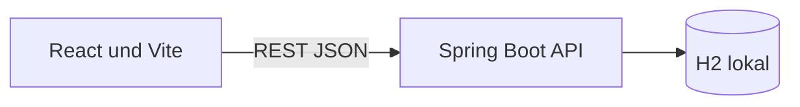

# MOTOCARE – Ride hard. Care smart.

**M245, Projekt Idea – Sprint 2, Full-Stack Proof of Concept.** MOTOCARE ist ein Motorradpflege-Abo als technischer Schulprototyp, kein realer Onlineshop. Kundinnen und Kunden erfassen Marke, Modell und Baujahr, wählen aus Pflegeboxen und verwalten ein Demo-Abonnement. Die Boxen heissen Wash, Service, Winter und Mystery. Die Servicebox ist aus Sicherheitsgründen gesperrt, bis echte OEM-Kompatibilitätsnachweise für Öl und Filter vorliegen.

## Warum diese Idee?

Motorradfahrer beschaffen Reinigungs- und Wartungsmittel oft einzeln. Die Suche nach den richtigen Produkten kostet Zeit, Lieferkosten fallen mehrfach an und ein falsches technisches Teil kann gefährlich sein. MOTOCARE soll einen transparenten Überblick über passende Boxen bieten und wiederkehrende Bestellungen vereinfachen. Für Wartungsteile wird eine verifizierte Fahrzeugzuordnung benötigt. Der Prototyp testet zuerst, ob eine digitale Produktauswahl und die Abo-Verwaltung technisch machbar sind. Ob echte Kundinnen und Kunden monatlich dafür bezahlen würden, muss ein Nutzertest noch belegen.

## Funktionen im PoC

1. Landingpage mit klarer Value Proposition und vier Boxen.
2. Boxenübersicht, Filter und Detail-Drawer mit Inhalten und Beispielpreisen.
3. Auswahl eines Motorradmodells und eines Intervalls.
4. Demo-Abo über die Spring-Boot-API anlegen.
5. Abos nach Demo-E-Mail laden, pausieren, fortsetzen und löschen.
6. Unsichere Servicebox serverseitig blockieren (HTTP 409).
7. Responsive Desktop-/Mobile-Layouts.
8. Lokale Datenpersistenz mit H2, ohne separaten Datenbankdienst.

## Architektur



Die lokale App läuft auf **http://localhost:8088**. Spring Boot liefert das gebaute React-Frontend und die REST-API gemeinsam aus. Die H2-Datenbank speichert Demo-Daten dauerhaft unter `backend/data/`. Es wird keine Container-Software benötigt.

## So startest du MOTOCARE ohne Docker

Voraussetzungen: **JDK 21 oder neuer**, **Node.js 22** und **Maven** im PATH. Auf diesem Rechner sind diese Werkzeuge bereits vorhanden. Das Startskript verwendet das Java aus dem PATH auch für Maven, damit ein veraltetes `JAVA_HOME` den Build nicht verhindert.

```powershell
.\start.ps1
```

Das Skript installiert die Frontend-Abhängigkeiten, führt Frontend- und Backend-Tests aus, baut die App und startet sie auf **http://localhost:8088**. Beim ersten Build ist Internetzugriff für Abhängigkeiten erforderlich. Stoppen mit **Strg+C**; gespeicherte Demo-Abos bleiben erhalten. Die App ist nur auf diesem Rechner erreichbar.

```powershell
# Nur bauen und testen
.\start.ps1 -BuildOnly
# Alternativer Port, falls 8088 belegt ist
.\start.ps1 -Port 8090
```

### Entwicklung mit automatischem Frontend-Reload

In zwei Terminals (für Maven muss JAVA_HOME auf JDK 21+ zeigen):

```powershell
# Terminal A
cd backend
mvn spring-boot:run

# Terminal B
cd frontend
npm ci
npm run dev
```

Entwicklungs-App: http://localhost:5173. Backend: http://localhost:8080/api/boxes.

## Automatische Tests

```bash
cd frontend && npm test && npm run build
cd ../backend && mvn test
```

Ein gemeinsamer GitHub-Actions-Workflow ist unter `.github/workflows/ci.yml` enthalten. Für die vom Projektauftrag geforderten **zwei getrennten GitHub-Repositories** je das Verzeichnis `frontend` und `backend` in ein eigenes Repo übertragen und die passenden Workflows aus dem Hauptprojekt übernehmen. Keine Zugangsdaten einchecken.

## UI-/Designkonzept

MOTOCARE setzt auf die visuelle Sprache einer technischen Motorradmarke statt eines generischen SaaS-Dashboards: dunkle Tinte, warmes Offwhite, Lime-Akzente, grosse Headlines, klare Produktstills und ein echtes Yamaha-R1-Foto. Mit responsivem Raster, reduzierter Navigation, nachvollziehbarer Produktauswahl und wiederverwendbaren Komponenten wurde die Nutzbarkeit priorisiert. Die Produktbilder sind bewusst selbst gezeichnete CSS-Kompositionen, keine Behauptung real existierender Markenartikel.

## Nachweise und offene Punkte

Die READMEs, Risikoanalyse, Testplanung, Architektur und ER-Diagramm liegen bei. Ein echter Live-Host, reale Interviewdaten und browserbasierte Screenshots sind nicht vorgetäuscht und müssen noch ergänzt werden. Die Beispielpreise wurden nicht durch eine Lieferantenkalkulation belegt. Keine Zahlung, keine automatisierte physische Lieferung, keine Prüfung von OEM-Teilen. Die Demo-E-Mail stellt **keinen sicheren Login** dar: öffentlich nur mit Testdaten verwenden.

Projektquellen: `04.0_Projekt-Idea-v1.md`, `05.0_FullStackPrototypAufgabe.pdf`, `245-Bewertungskriterien.md`, `04.0_Projekt_Idea-präsentieren_beobachten.pdf`.


Beim erneuten Start wird die laufende Projektinstanz nach erfolgreichem Build ersetzt. Die laufende JAR liegt in `.runtime/` statt im Maven-Buildordner; Logs stehen in `.runtime/app.log` und `.runtime/app-error.log`. Unveränderte Frontend-Abhängigkeiten werden wiederverwendet.

Motorradfoto: [Kirill Petropavlov / Unsplash](https://unsplash.com/photos/black-motorcycle-Wbtuuty_dHo), siehe `frontend/public/images/CREDITS.md`.


## Online-Demo

Frontend: https://motocare-azure.vercel.app

Die Vercel-Version zeigt die Oberfläche mit dem Demo-Katalog. Abo-Speicherung und -Verwaltung benötigen das separat gehostete Backend; dieses ist noch nicht verbunden.

Aktualisieren: im Verzeichnis frontend den Befehl `npx vercel --prod` ausführen.

