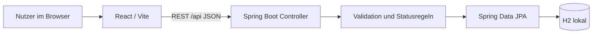
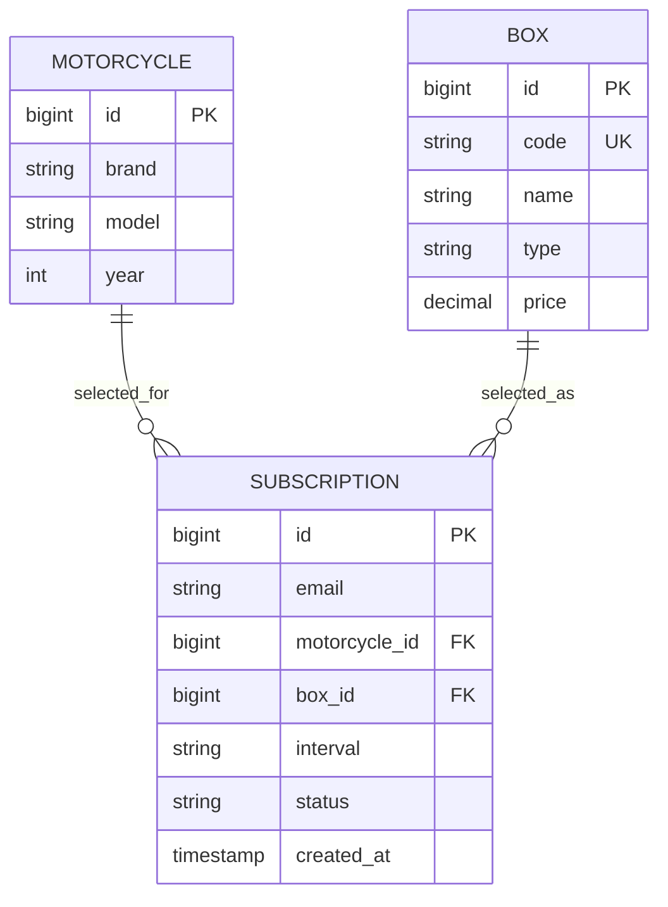

# Architektur und Datenmodell

## Systemübersicht

## ER-Diagramm (PoC)

### Einschränkung

`Compatibility` wurde **absichtlich noch nicht** als echte Teilefreigabe implementiert. Die spätere produktive Ausbaustufe benötigt eine OEM-basierte Tabelle mit Motorradvariante, Material/Teilenummer, Gültigkeit, Quellenbeleg und Freigabestatus. Solange diese Daten fehlen, sperrt das Backend Servicebox-Buchungen grundsätzlich.

## Nicht-funktionale Anforderungen

- Verständliche responsive Darstellung.
- Persistente Speicherung der Demo-Abos.
- Serverseitige Eingabevalidierung.
- Keine ungeprüfte Servicebox-Buchung.
- Vor echtem Betrieb: Authentifizierung, Autorisierung, sichere Secrets, Produkt-/Zahlungsdatensicherheit.

